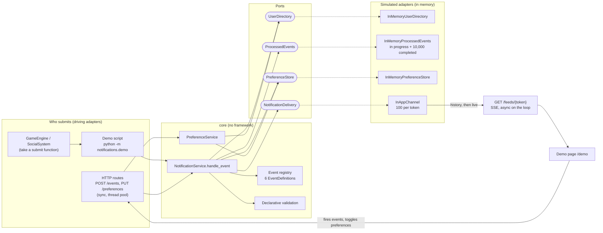
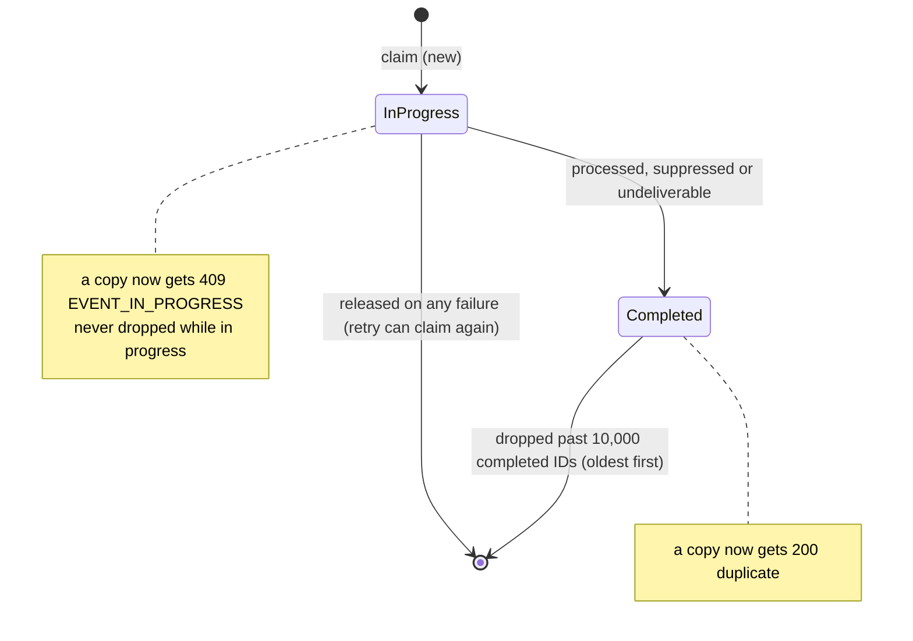

# Architecture

The final design on one page. How it got here, with every option and decision, is in the feature specs (`docs/features/`) and the decision log (`docs/ai-process/README.md`).

## Purpose
Game and social systems submit events. The module validates each event, decides who to notify, rejects duplicates, checks that player's preferences, builds a message and hands it to the in-app channel. Everything runs in one process with simulated dependencies.

## Components
Ports and adapters (hexagonal). The rules live in a core with no web framework (enforced by `tests/test_architecture.py`). The core defines small interfaces (ports). Adapters drive it from the outside or implement its ports. The wiring is chosen in one place, `build_simulated()`, used by both the app and the demo script.

## Processing order, and why
1. **Validate** the payload against the event type's field specs. Unknown fields and wrong kinds are rejected (`422`).
2. **Reject self-targeting** (a friend request to yourself) before any lookup.
3. **Look up** the recipient, and the actor whose name the message uses. An unknown player is rejected (`422`).
4. **Claim the `event_id`.** Rejected events never use up their ID, so a corrected resend works.
5. **Check the preference.** Off means `suppressed`. It comes after the claim, so turning the category back on never replays the event.
6. **Check the token.** None or blank means `undeliverable`, by design: replaying a backlog of in-game popups on connect would flood the player.
7. **Build the notification**, carrying the `event_id`, and **deliver once**.
8. **Complete the ID** on any final outcome, or **release it** if anything after the claim raised.

## Event-ID lifecycle

## Guarantees, stated precisely
- **Delivery.** The module makes one delivery attempt per processing attempt. Failed attempts can be retried using the same event ID. An uncertain delivery outcome can produce duplicates; receivers can use the event ID to deduplicate.
- **Duplicates.** A copy of a completed ID is answered `200 duplicate` and delivers nothing. A copy of an ID still in progress is answered `409 EVENT_IN_PROGRESS`, so a consumer does not acknowledge it while the first copy may still fail.
- **What it does not guarantee.** The standalone module does not guarantee at-least-once delivery: state is in memory, undeliverable events are dropped by design, there is no durable pending work, and producer retries are not enforced. It supports an at-least-once workflow only when combined with producer retries and durable storage.
- **Delivered** means handed to the in-app channel, not seen or read by the player.

## Answers a producer gets
| Answer | Meaning | Retry? |
|---|---|---|
| `200 processed` | Delivered to the channel | No |
| `200 suppressed` / `undeliverable` / `duplicate` | Final, nothing delivered | No |
| `409 EVENT_IN_PROGRESS` | Another copy is still running | Later, same `event_id` |
| `422` with a code | The event is invalid | Only after fixing it |
| `503 DELIVERY_FAILED` | The channel is down | Yes, same `event_id` |
| `500` | A bug | No |

## Concurrency model
- The core is synchronous. The event and preference routes are plain `def`, so FastAPI runs them in its thread pool, and a slow delivery does not block other requests or open feeds (tested with a 150 ms delivery).
- Shared state is guarded by locks: the event-ID store, the preference store and the channel. The user directory is read only.
- Live feeds are `async` on the event loop. The channel hands each live item to the feed's loop with `call_soon_threadsafe`, so delivery can run on any thread. A feed's outstanding items are bounded (100) before anything is scheduled. A feed that stops reading is closed, delivery is unaffected, and the browser reconnects and gets everything as history.
- Taking a feed's history and registering it for live items happen under the same lock as delivery, so each notification is either history or live, never both and never lost.

## What extends cheaply, and what does not
- **Cheap:** another event shaped like the six (one recipient, at most one actor, flat fields) is one `EventDefinition`. Another transport (a broker consumer, WebSocket intake) is another adapter calling `handle_event`. Another store or channel implementation is another adapter behind its port.
- **A model change:** notifying several recipients, several actors, several devices per player, another channel such as email, per-channel preferences, localisation or nested event data. Each needs the core's model and ports extended, not just a new definition.

## Known limits
In memory and single process (restart forgets IDs, preferences and the channel). No authentication. Undeliverable notifications are dropped; history is assumed to live outside the module. Names are looked up when the event is processed, not when it happened. Strict validation makes a new producer field a breaking change. The full list is in the README.
